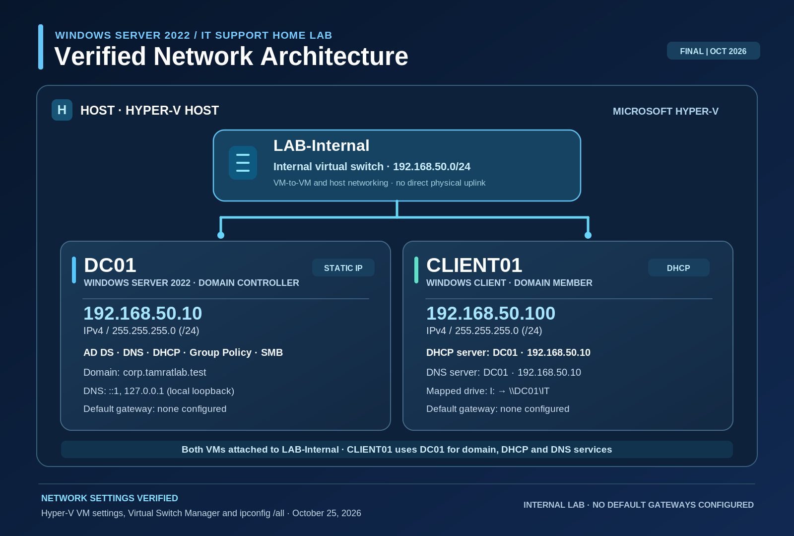
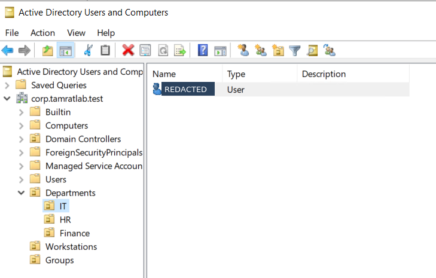
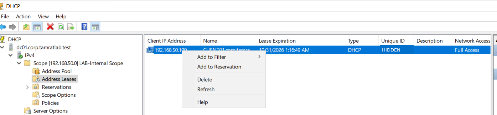
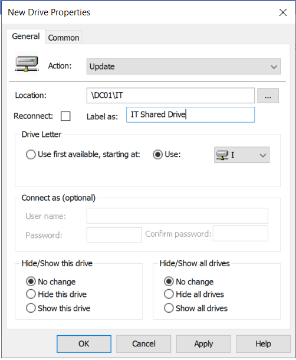
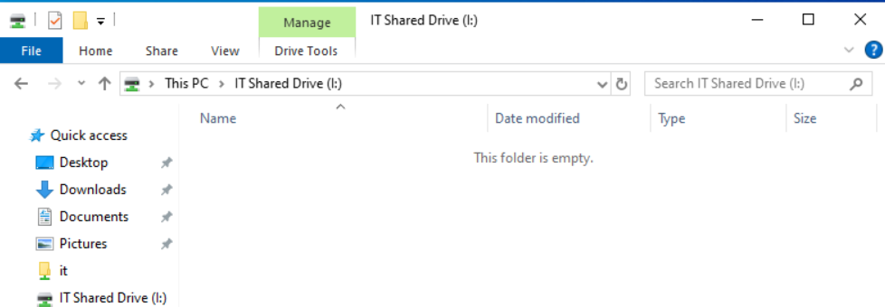

# Windows Server 2022 Active Directory & IT Support Home Lab

### Enterprise IT Infrastructure | Active Directory | Networking | Help Desk Troubleshooting

**Project Status:** Technical Build 100% Complete  
**Environment:** Microsoft Hyper-V | Windows Server 2022 | Windows 10  
**Project Type:** Hands-On IT Support and Systems Administration Home Lab

---

## 1. Project Overview

Designed, configured, and tested a virtualized Windows enterprise environment using Microsoft Hyper-V and Windows Server 2022.

The project simulates common responsibilities performed by IT Support Technicians, Service Desk Analysts, and Junior Systems Administrators, including:

- Active Directory user and group administration
- Domain-joined Windows workstation support
- DNS and DHCP configuration
- Group Policy administration
- Shared-folder access and network drive mapping
- Password resets and account troubleshooting
- Group membership and access validation
- Windows command-line troubleshooting

The goal was to gain practical experience supporting users and managing Windows infrastructure in a controlled enterprise-style environment.

> **Note:** This is a personal, non-production lab. All accounts, systems, and network configurations were created for hands-on learning and demonstration.

---

## 2. Network Architecture



The environment consists of two virtual machines connected through a Hyper-V internal virtual switch.

### Infrastructure Components

| Component | Configuration |
|---|---|
| Hypervisor | Microsoft Hyper-V |
| Domain Controller | DC01 |
| Server Operating System | Windows Server 2022 |
| Client Workstation | CLIENT01 |
| Client Operating System | Windows 10 |
| Active Directory Domain | corp.tamratlab.test |
| Virtual Switch | LAB-Internal |
| Switch Type | Internal |
| Network Subnet | 192.168.50.0/24 |
| DC01 IPv4 Address | 192.168.50.10 (Static) |
| CLIENT01 IPv4 Address | 192.168.50.100 (DHCP) |
| DHCP Server | DC01 |
| DNS Server for CLIENT01 | DC01 |
| Default Gateway | Not configured |

### Network Design

Both virtual machines use the LAB-Internal virtual switch.

DC01 provides centralized directory and network services, while CLIENT01 functions as a domain-connected workstation for administration, policy testing, and help desk troubleshooting.

CLIENT01 receives its IPv4 configuration from the DHCP service hosted on DC01 and uses DC01 for DNS resolution.

The internal virtual switch provides a controlled lab network without a direct physical-network uplink.

---

## 3. Technologies and Tools

| Technology | Purpose |
|---|---|
| Windows Server 2022 | Server operating system and domain services |
| Windows 10 | Domain-joined client workstation |
| Microsoft Hyper-V | Virtual machine hosting and networking |
| Active Directory Domain Services | Centralized user and computer management |
| Active Directory Users and Computers | User, group, and OU administration |
| DNS | Domain name resolution |
| DHCP | Dynamic client IP address allocation |
| Group Policy Management | Centralized Windows configuration |
| Windows File Sharing | Shared resource management |
| NTFS Permissions | File-system access control |
| PowerShell | Windows administration and troubleshooting |
| Command Prompt | Network and account diagnostics |

---

## 4. Active Directory Implementation

Configured Active Directory Domain Services to provide centralized identity management in the lab environment.

### Organizational Unit Structure

Created departmental organizational units to organize users and support administrative and policy management.

The structure includes:

- Departments
  - IT
  - HR
  - Finance
- Workstations
- Groups

### User and Group Administration

Performed Active Directory administration exercises involving:

- Creating and managing domain user accounts
- Organizing accounts in departmental OUs
- Creating security groups
- Managing group membership
- Resetting user passwords
- Investigating disabled and locked accounts
- Validating domain account sign-in

Security groups used during the exercises include `GG_IT_Users` and `GG_HR_Users`.

### Evidence: Active Directory



*Active Directory domain structure and departmental organizational units.*

[View Active Directory Security Groups](screenshots/02_Active_Directory_security_groups.png)

---

## 5. DNS and DHCP Configuration

### DNS

Configured DNS services within the Windows Server environment to support Active Directory and domain client operations.

Verified that CLIENT01 uses DC01 (`192.168.50.10`) as its DNS server.

DNS administration exercises also included working with forward and reverse lookup zones and examining DNS resource records.

### DHCP

Configured a DHCP scope for the internal lab network.

**Verified DHCP configuration:**

- Network: `192.168.50.0/24`
- DHCP server: `192.168.50.10`
- Client: `CLIENT01`
- Assigned client address: `192.168.50.100`

The client's `ipconfig /all` output confirms that DHCP is enabled and that DC01 is its DHCP and DNS server.

### Evidence: DHCP Address Lease



*DHCP Management showing a client address lease on the internal lab network.*

---

## 6. Group Policy Administration

Used Group Policy Management to practice centralized Windows administration.

Exercises included:

- Creating and managing Group Policy Objects
- Working with organizational-unit-linked policies
- Reviewing workstation configuration and security settings
- Configuring Group Policy Preferences for mapped drives
- Refreshing policies using `gpupdate /force`
- Investigating policy application through Windows diagnostic tools

### Group Policy Drive Mapping

Configured a network drive mapping using Group Policy Preferences.

| Setting | Configuration |
|---|---|
| Shared Resource | `\\DC01\IT` |
| Drive Label | IT Shared Drive |
| Drive Letter | I: |
| Preference Action | Update |

### Evidence: Drive Mapping Policy



*Group Policy Preferences configuration for the IT shared drive.*

---

## 7. File Sharing and Access Management

Configured shared network resources to simulate departmental file access in an enterprise environment.

Administrative exercises included:

- Creating shared folders
- Configuring Windows share permissions
- Working with NTFS access permissions
- Assigning access through security groups
- Mapping a network drive to a client workstation
- Investigating group membership and shared-resource access

### Evidence: Shared Folder Permissions

[View IT Share Group Permissions](screenshots/05_IT_share_group_permissions.png)

### Evidence: Client Mapped Drive



*Windows File Explorer showing the mapped IT Shared Drive (I:) on the client workstation.*

The mapped-drive screenshot demonstrates drive visibility. Detailed access permissions and file operations are documented separately where applicable.

---

## 8. IT Help Desk Troubleshooting Exercises

The lab also included practical support scenarios similar to those encountered in Tier 1 IT Support and Service Desk environments.

### Scenario 1: Password Reset and Account Access

**Support request:** A domain user requires assistance accessing their Windows account.

**Troubleshooting and administration activities:**

1. Locate the affected user in Active Directory Users and Computers.
2. Review the account status.
3. Perform the appropriate account administration action.
4. Apply password-reset or account-access settings as required.
5. Verify the user's ability to sign in.

**Skills demonstrated:** Active Directory administration, identity troubleshooting, password management, and user support.

### Scenario 2: Disabled User Account

**Support request:** A previously configured user cannot sign in because the account is disabled.

**Troubleshooting approach:**

1. Identify the affected user account in Active Directory.
2. Inspect whether the account is enabled or disabled.
3. Restore access when authorized as part of the lab exercise.
4. Test the user's domain sign-in.
5. Verify the outcome.

**Skills demonstrated:** Account-state troubleshooting, access restoration, and authentication verification.

### Scenario 3: Group Membership and Resource Access

**Support request:** A domain user needs access to an IT departmental resource.

**Troubleshooting approach:**

1. Review the user's Active Directory group membership.
2. Inspect the resource's associated security group.
3. Compare share permissions and NTFS permissions.
4. Refresh Group Policy and recheck the user's session where appropriate.
5. Verify the resulting group membership and mapped-drive visibility.

**Skills demonstrated:** Access control, Active Directory security groups, Group Policy troubleshooting, and Windows file sharing.

### Scenario 4: Windows Network Troubleshooting

**Support request:** A domain-connected client requires network configuration verification.

**Troubleshooting tools:**

```cmd
ipconfig /all
gpupdate /force
whoami /groups
net use
```

These commands were used during the lab to inspect IP configuration, refresh Group Policy, examine security group membership, and troubleshoot mapped network resources.

**Skills demonstrated:** Command-line diagnostics, networking fundamentals, Windows client support, and systematic troubleshooting.

---

## 9. Configuration Validation

The following technical details were verified during the lab and portfolio documentation process.

| Validation Check | Verified Result |
|---|---|
| Hyper-V virtual machines | DC01 and CLIENT01 configured |
| Virtual switch | Both VMs connected to LAB-Internal |
| Switch type | Internal |
| DC01 static IPv4 address | 192.168.50.10 |
| CLIENT01 DHCP address | 192.168.50.100 |
| DHCP server used by client | 192.168.50.10 |
| DNS server used by client | 192.168.50.10 |
| Active Directory domain | corp.tamratlab.test |
| Organizational units | IT, HR, Finance, Workstations, Groups |
| Security groups | Departmental groups configured |
| Group Policy | Management and drive-mapping configuration demonstrated |
| Shared resources | IT shared folder and client drive mapping demonstrated |

These observations are based on lab administration, validation commands, and captured screenshots. They are not claims of performance testing, production deployment, or security certification.

---

## 10. Project Challenges and Troubleshooting

The project involved diagnosing configuration and access issues across multiple connected Windows services.

Key troubleshooting areas included:

**Active Directory administration:** Investigating user account status and group membership to understand authentication and resource access.

**Group Policy processing:** Applying policy updates and inspecting client-side results when expected settings did not immediately appear.

**Mapped network drives:** Checking drive mappings, security group membership, shared-folder configuration, and access permissions.

**DNS and network settings:** Reviewing server and client network configurations to verify IP addressing and DNS server assignment.

These exercises reinforced the importance of validating a configuration from both the server and client perspectives rather than assuming a successful setup based on the management console alone.

---

## 11. Skills Demonstrated

### IT Support and Service Desk

- Windows desktop troubleshooting
- Account access and password-reset support
- Incident investigation and problem isolation
- Domain-user authentication troubleshooting
- Remote and virtualized Windows administration

### Systems Administration

- Windows Server 2022
- Active Directory Domain Services
- Organizational units and security groups
- Group Policy Management
- Windows file sharing and access permissions

### Networking

- Private IPv4 addressing
- Subnet configuration
- DNS and DHCP administration
- Virtual switching
- Network configuration validation

### Technical Documentation

- Network architecture documentation
- Screenshot-based technical evidence
- Configuration verification
- Troubleshooting workflow documentation

---

## 12. Project Evidence

This repository contains selected screenshots and supporting documentation from the completed Home Lab.

| Evidence | Description |
|---|---|
| [Network Architecture](Home_Lab_Network_Architecture_Public_Safe.png) | Verified virtualization and network topology |
| [Active Directory OUs](screenshots/01_Active_Directory_organizational_units.png) | Domain organizational structure |
| [Security Groups](screenshots/02_Active_Directory_security_groups.png) | Departmental security groups |
| [DHCP Address Lease](screenshots/03_DHCP_client_address_lease.png) | Client DHCP allocation |
| [Group Policy Drive Mapping](screenshots/04_Group_Policy_drive_mapping.png) | Shared drive policy configuration |
| [Share Permissions](screenshots/05_IT_share_group_permissions.png) | IT shared-resource permission configuration |
| [Mapped Network Drive](screenshots/06_CLIENT01_mapped_drive.png) | Drive visibility on CLIENT01 |

Only selected, sanitized evidence is included. Screenshots may be cropped or have nonessential identifiers redacted, but the technical results have not been fabricated.

---

## 13. Security and Privacy

This project uses a private laboratory network and test domain.

The published materials have been prepared to avoid unnecessarily exposing the physical host's computer name, authentication credentials, hardware identifiers, and other unrelated information.

The private IP addresses are retained to demonstrate the actual networking configuration.

No virtual machine disks, account passwords, production data, or private authentication materials are required to review the project.

---

## 14. Project Outcome

Successfully completed a Windows Server 2022 and Hyper-V Home Lab designed to demonstrate practical IT Support and foundational systems administration skills.

The project provided hands-on experience supporting a Windows domain environment, managing user accounts, configuring network services, applying administrative policies, investigating access issues, and documenting verified technical configurations.

The finished lab serves as a portfolio demonstration for IT Support Technician, Help Desk Technician, Service Desk Analyst, Desktop Support, and Junior Systems Administrator opportunities.

---

**Project Repository:** [Windows Server 2022 IT Support Home Lab](https://github.com/tamrat-dev-source/windows-server-2022-it-support-homelab)

**Environment:** Personal technical training lab | October 2026
